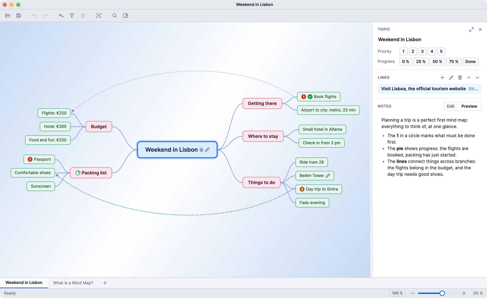

<p align="center"></p>

# MindBuzz

Mind maps for Windows, macOS and Linux, made for the keyboard: a balanced map, relationships between topics, links,
Markdown notes, markers, search, several maps per file, encryption and PNG export, in a calm light and dark look.

Runs on Windows 10 and 11 (64-bit), macOS 14 or later (Apple silicon and Intel) and 64-bit Linux (x64 and ARM64)
with an X11 or Wayland desktop.

<picture>
  <source media="(prefers-color-scheme: dark)" srcset="docs/screenshot-dark.png">
  
</picture>

**Vibe coded.** MindBuzz is written by an AI coding agent (Claude Code) from a specification,
with a human deciding, testing and reviewing every change.

- **Keyboard first.** Every command has a key and is also in a menu.
- **Nothing left behind.** No settings, no registry, no recent files; only your documents and, while there are
  unsaved changes, a recovery file next to them.
- **Almost no network.** No telemetry, no account. At start MindBuzz asks GitHub whether a newer version exists,
  and sends nothing else; a link opens in your browser only when you ask.

Try **File › New Sample Mind Maps** for a first look. All shortcuts per platform:
[docs/keyboard.md](docs/keyboard.md).

## Building

Needs the .NET 10 SDK. On Windows use `build.cmd` with the same options.

```sh
./build.sh                  # build Release and run all tests
./build.sh --publish        # the release build for this machine, in artifacts/ (on macOS with MindBuzz.app)
./build.sh --help           # every option
./run.sh                    # build and start the app (Release); run.cmd on Windows
```

On macOS the app is not signed. After copying it from another machine, run once:
`xattr -dr com.apple.quarantine MindBuzz.app`

On Linux the release is one file. If copying lost its execute bit: `chmod +x MindBuzz`

## Licence

[AGPL-3.0](LICENSE). Bundled components: [THIRD-PARTY-NOTICES.txt](THIRD-PARTY-NOTICES.txt).
